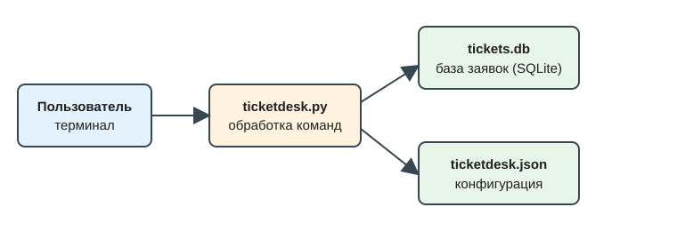
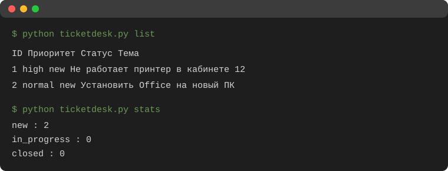

# TicketDesk — документация

**Разделы документации:** [Главная](index.md) | [Быстрый старт](quick-start.md) | [Установка](installation.md) | [Руководство](user-guide.md) | [Справка](reference.md) | [FAQ](faq.md) | [Неисправности](troubleshooting.md)

---

**TicketDesk** — консольная система учёта заявок. Она позволяет создавать заявки, назначать им приоритет, переводить по статусам и выгружать данные в CSV. Программа написана на Python и хранит данные в локальной базе SQLite, поэтому не требует сервера.

## Для кого эта документация

Документация предназначена для сотрудников технической поддержки и администраторов небольших организаций, которым нужно быстро начать вести учёт обращений. Опыт программирования не требуется, достаточно уметь запускать команды в терминале.

## Назначение

Система заменяет разрозненные таблицы и переписку единым журналом заявок. Каждая заявка имеет автора, приоритет, статус и время изменения, поэтому всегда видно, что уже сделано и что ещё ожидает обработки.

## Основные возможности

- создание заявок с указанием автора и приоритета;
- перевод заявки по статусам: **new → in_progress → closed**;
- фильтрация списка по статусу и приоритету;
- статистика по количеству заявок в каждом статусе;
- экспорт всех заявок в файл CSV;
- настройка через файл `ticketdesk.json`.

## Как устроена система

Программа принимает команду от пользователя, читает параметры из конфигурации и записывает результат в базу данных.

## Интерфейс программы

## Документация

1. [Быстрый старт](quick-start.md) — создать первую заявку за 5 минут.
2. [Установка и настройка](installation.md) — требования, установка, файл конфигурации.
3. [Руководство пользователя](user-guide.md) — все основные операции пошагово.
4. [Справочная информация](reference.md) — команды, параметры, статусы, коды завершения.
5. [FAQ](faq.md) — ответы на частые вопросы.
6. [Устранение неисправностей](troubleshooting.md) — что делать при ошибках.

> **Важно:** если вы работаете с системой впервые, начните с раздела [Быстрый старт](quick-start.md).
